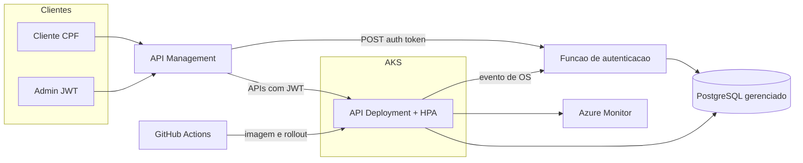

# WrenchBox API

Backend para gestão de oficinas mecânicas: ordens de serviço, clientes, veículos, catálogo, estoque e a área do cliente. A API roda no AKS, autentica administrador e cliente por JWT e publica a imagem pelo GitHub Actions. O desenho segue Clean Architecture, com testes automatizados. O Kind, o Postgres em pod e o MailHog existem só para o ensaio local.

## Arquitetura

Clean Architecture em camadas (o Domain não depende de Infrastructure):

| Projeto | Papel |
|---------|--------|
| `WrenchBox.Domain` | Entidades, value objects, regras e portas de persistência |
| `WrenchBox.Application` | Casos de uso (MediatR), DTOs, validação |
| `WrenchBox.Infrastructure` | Adaptadores: EF Core, PostgreSQL, JWT, SMTP |
| `WrenchBox.Api` | Adaptador HTTP: controllers, Swagger, health, webhooks |



Fluxo de deploy: testes no pull request → imagem no GHCR nas branches `homolog` e `main` → rollout no AKS (`wrenchbox-homolog` ou `wrenchbox-prod`). O cluster, o API Management, o PostgreSQL gerenciado e a função de autenticação vivem nos repositórios separados descritos em [docs/arquitetura/README.md](docs/arquitetura/README.md). O Kind com Postgres em pod e MailHog fica só no ensaio local.

## Fase 3

| Repositório | Onde está agora | Papel |
|-------------|-----------------|--------|
| Função serverless | `temp/wrenchbox-serverless` | CPF, status do cliente e JWT; notificações |
| Kubernetes (Terraform) | `temp/wrenchbox-k8s-infra` | AKS, Traefik, API Management, Azure Monitor |
| Banco gerenciado (Terraform) | `temp/wrenchbox-db-infra` | PostgreSQL Flexible Server e Key Vault |
| Esta aplicação | este git | API no Kubernetes |

A pasta `temp/` não entra neste git. Cada pasta vira um repositório próprio. Slides e roteiro do vídeo: `temp/apresentacao`. Página da entrega no portal: `temp/entrega-portal`.

## APIs de ordem de serviço

| Requisito | Endpoint |
|-----------|----------|
| Abertura de OS | `POST /api/v1/work-orders` — devolve `id` e `orderNumber` |
| Consulta de status | `GET /api/v1/work-orders/{id}/status` — `status` + `statusLabel` em português |
| Aprovação/recusa de orçamento | `POST /api/v1/tracking/work-orders/decision` `{ "approved": true\|false }` ou, com JWT de cliente, `POST /api/v1/me/work-orders/{id}/decision` |
| Área do cliente | `GET /api/v1/me/work-orders` — exige JWT com role `Customer` emitido em `POST /auth/token` |
| Listagem operacional | `GET /api/v1/work-orders` — Execução > Aguardando Aprovação > Diagnóstico > Recebida; mais antigas primeiro; exclui Finalizada/Entregue |
| Status via e-mail | SMTP + MailHog; links no e-mail; `POST /api/v1/webhooks/work-order-status` |

Collection: [docs/WrenchBox.postman_collection.json](docs/WrenchBox.postman_collection.json)  
Swagger (local): http://localhost:8080/swagger  
Referência: [docs/api-endpoints.md](docs/api-endpoints.md)

## Execução local

Pré-requisitos: [.NET 8 SDK](https://dotnet.microsoft.com/download) e [Docker Desktop](https://www.docker.com/products/docker-desktop/).

```bash
cp .env.example .env
docker compose up --build
```

- API: http://localhost:8080
- Swagger: http://localhost:8080/swagger
- MailHog: http://localhost:8025
- Admin: `admin@wrenchbox.local` / `Admin@123`

```bash
docker compose up db mailhog -d
dotnet run --project src/WrenchBox.Api
```

Swagger em http://localhost:5000/swagger.

## Kubernetes

Os manifestos em `k8s/` descrevem só a API (Deployment, Service ClusterIP e HPA). Postgres e MailHog ficam no Compose e em `k8s/local/` para o Kind. O segredo não é versionado: copie [k8s/secret.yaml.example](k8s/secret.yaml.example).

```bash
docker build -t wrenchbox:latest .
kind create cluster --name wrenchbox --config infra/kind-config.yaml
kind load docker-image wrenchbox:latest --name wrenchbox
kubectl apply -f k8s/namespace.yaml
kubectl apply -f k8s/local/configmap.yaml
kubectl apply -f k8s/local/postgres-deployment.yaml
kubectl apply -f k8s/local/mailhog-deployment.yaml
kubectl apply -n wrenchbox -f k8s/api-deployment.yaml
kubectl apply -n wrenchbox -f k8s/hpa.yaml
kubectl -n wrenchbox port-forward svc/wrenchbox-api 8080:8080
```

### HPA

```bash
kubectl -n wrenchbox get hpa -w
# em outro terminal
hey -z 60s -c 20 http://localhost:8080/api/v1/diagnostics/load
```

## Terraform

Provisiona o cluster Kind, o metrics-server e o PostgreSQL. Detalhes em [infra/README.md](infra/README.md).

```bash
cd infra
terraform init
terraform apply
cd ..
docker build -t wrenchbox:latest .
kind load docker-image wrenchbox:latest --name wrenchbox
kubectl apply -k k8s
```

## CI/CD

Pipeline em [.github/workflows/ci-cd.yml](.github/workflows/ci-cd.yml):

1. `dotnet restore` / `build` / `test` em pull request e push
2. `terraform init` + `terraform validate` do Kind local em `infra/`
3. Push de `homolog` e `main`: imagem no GHCR. O rollout no AKS só roda quando os segredos OIDC e as variáveis do cluster estão cadastrados; sem eles o job avisa e segue, em vez de falhar no login
4. Smoke no Kind só por `workflow_dispatch`

Branches `main` e `homolog` devem estar protegidas, com merge apenas por pull request. O script `temp/publicar-github.ps1` aplica essa proteção e convida `soat-architecture` depois que os quatro repositórios existirem no GitHub.

Segredos do workflow: `AZURE_CLIENT_ID`, `AZURE_TENANT_ID`, `AZURE_SUBSCRIPTION_ID`. Variáveis: `AZURE_RESOURCE_GROUP`, `AKS_CLUSTER_NAME`.

## Produção (hardening)

Em `Production`, seed e Swagger ficam **desligados** por padrão (`Seed:Enabled`, `Swagger:Enabled`). O ambiente Kind de demonstração religa os dois via ConfigMap. Login tem rate limit (10 tentativas/minuto). A API envia `X-Content-Type-Options`, `X-Frame-Options` e `X-Request-Id`.

## Testes

```bash
dotnet test
```

Unitários (Domain/Application) e integração com Testcontainers (PostgreSQL). Meta: ≥ 80% de linhas em Domain e Application.
