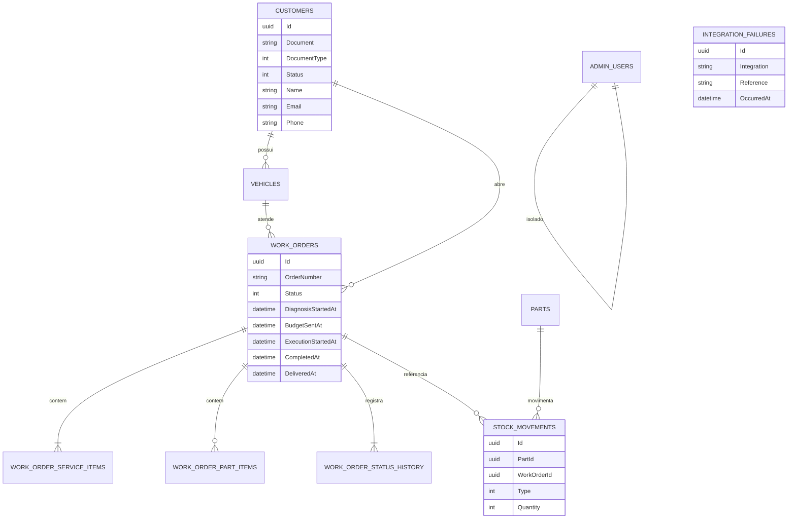

# Banco de dados

## Justificativa

O WrenchBox já modela a oficina como um conjunto de agregados relacionais: cliente, veículo, ordem de serviço, itens, histórico e estoque. Uma OS aprova orçamento e baixa estoque na mesma transação. PostgreSQL entrega essa transação, integridade referencial, constraints e índices com um custo previsível.

Nesta fase o banco deixa de ser um pod e passa a ser o **Azure Database for PostgreSQL Flexible Server**, versão 16, a mesma major já usada no Compose e nos testes com Testcontainers. O serviço gerenciado cobre backup, TLS obrigatório, firewall e uma operação que não depende do ciclo de vida do cluster.

Ajustes deste incremento:

- `customers.document_type` e `customers.status` (Ativo, Inativo, Bloqueado). A função de autenticação precisa dos dois sem reimplementar a regra só na aplicação.
- Índice único de documento permanece. Índice em `status` apoia a consulta da função e relatórios.
- Índice `(status, created_at)` e índices dos marcos de tempo da OS apoiam o volume diário e as médias de Diagnóstico, Execução e Finalização.
- `stock_movements.work_order_id` referencia `work_orders` com `ON DELETE SET NULL`. A movimentação de estoque deixa de apontar para uma OS inexistente.
- Tabela `integration_failures` guarda falha de notificação para o endpoint de operações e para o alerta.
- Papel `wrenchbox_app` para a API e papel `wrenchbox_auth` com leitura restrita do cliente para a função. As senhas nascem no Key Vault.

Itens da OS continuam como fotografia do preço e do nome. A decisão está na [ADR 005](adr/005-snapshot-itens.md).

Dois databases no mesmo servidor (`wrenchbox_homolog` e `wrenchbox_prod`) cabem no crédito Azure for Students. Separar servidores é a evolução descrita na [ADR 006](adr/006-namespaces-compartilhados.md).

## Diagrama ER

`WORK_ORDER_SERVICE_ITEMS.service_id` e `WORK_ORDER_PART_ITEMS.part_id` não têm chave estrangeira de propósito: o catálogo pode mudar de preço ou ser desativado sem reescrever a OS já emitida.
