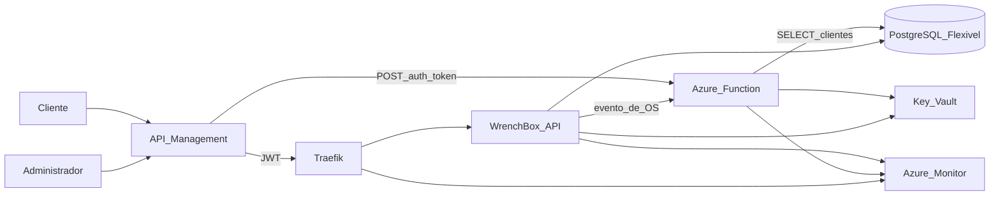

# Diagrama de componentes

A oficina passa a ter uma borda única, uma função de identidade, a API no Kubernetes e um PostgreSQL gerenciado. O mesmo desenho existe em menor escala no Compose de demonstração (`temp/wrenchbox-local-demo`), com Traefik no lugar do API Management e Grafana no lugar do Azure Monitor.

| Componente | Responsabilidade |
|------------|------------------|
| API Management | Roteia `/auth/token` para a função e as demais rotas para o AKS. Exige JWT de cliente em `/api/v1/me` e JWT de administrador nas rotas operacionais. `/health` fica aberto. |
| Azure Function | Valida o CPF, lê existência e status do cliente e emite o JWT. A segunda função envia o e-mail da ordem de serviço. |
| AKS + Traefik | Executa a API. O HPA mantém de 1 a 4 réplicas. O serviço da API é ClusterIP. |
| PostgreSQL Flexible Server | Banco gerenciado, TLS obrigatório, dois databases (`wrenchbox_homolog` e `wrenchbox_prod`) e papéis separados para a API e para a função. |
| Key Vault | Segredo JWT, senhas e connection strings. A identidade da função e o workflow leem por RBAC. |
| Azure Monitor | Latência HTTP, CPU e memória do cluster, disponibilidade de `/health`, logs JSON com trace id e alerta quando o texto `WorkOrderProcessingFailed` aparece. |
