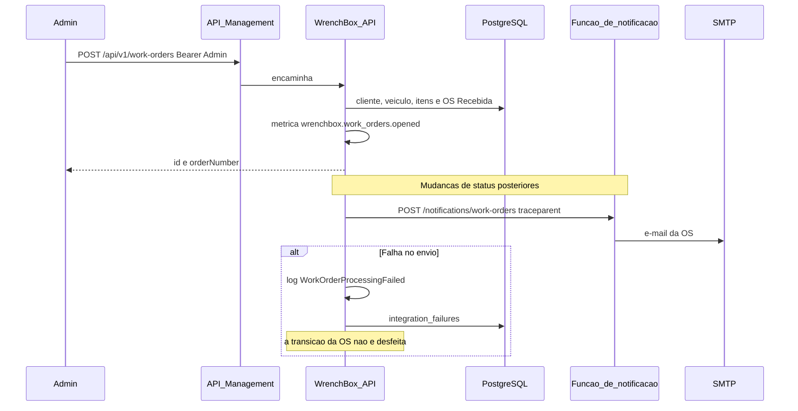

# Sequência — abertura de ordem de serviço

A abertura continua sendo uma operação do administrador. A notificação saiu do processo da API quando `Notify:BaseUrl` está configurado.

Tempos médios expostos em `GET /api/v1/metrics/operations` e nas métricas OpenTelemetry:

- Diagnóstico: `DiagnosisStartedAt` até `BudgetSentAt`
- Execução: `ExecutionStartedAt` até `CompletedAt`
- Finalização: `CompletedAt` até `DeliveredAt`
