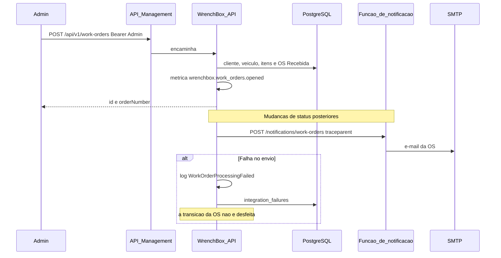

# Sequência — abertura de ordem de serviço

Quem abre a ordem é o administrador, já autenticado. A API grava cliente, veículo, itens e a ordem com status Recebida, e conta essa abertura na métrica de volume. O e-mail não sai mais de dentro do processo da API quando `Notify:BaseUrl` está configurado: a API publica o evento na função e propaga o `traceparent`. Se o envio falha, a transição da ordem permanece. O que fica é o log `WorkOrderProcessingFailed`, a métrica de integração e uma linha em `integration_failures`.

Os tempos médios aparecem em `GET /api/v1/metrics/operations` e nas métricas OpenTelemetry.

- Diagnóstico vai de `DiagnosisStartedAt` até `BudgetSentAt`.
- Execução vai de `ExecutionStartedAt` até `CompletedAt`.
- Finalização vai de `CompletedAt` até `DeliveredAt`.
