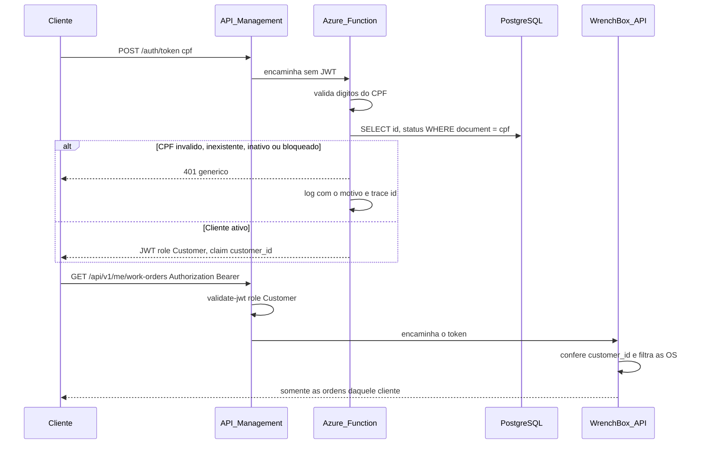

# Sequência — autenticação por CPF

O cliente não escolhe senha. Ele informa o CPF. A função confere os dígitos, procura a linha em `customers` e lê o status. Só um cliente Ativo recebe token. Se o CPF é inválido, se não existe ou se o cliente está inativo ou bloqueado, a resposta é sempre a mesma. O motivo fica no log, junto do trace id, para o operador.

O administrador continua entrando em `POST /api/v1/auth/login`, com e-mail e senha. O gateway deixa essa rota aberta e exige o papel `Admin` no restante de `/api/v1`. O acompanhamento pelo link do e-mail e o webhook ficam de fora dessa regra: cada um tem o próprio segredo.
