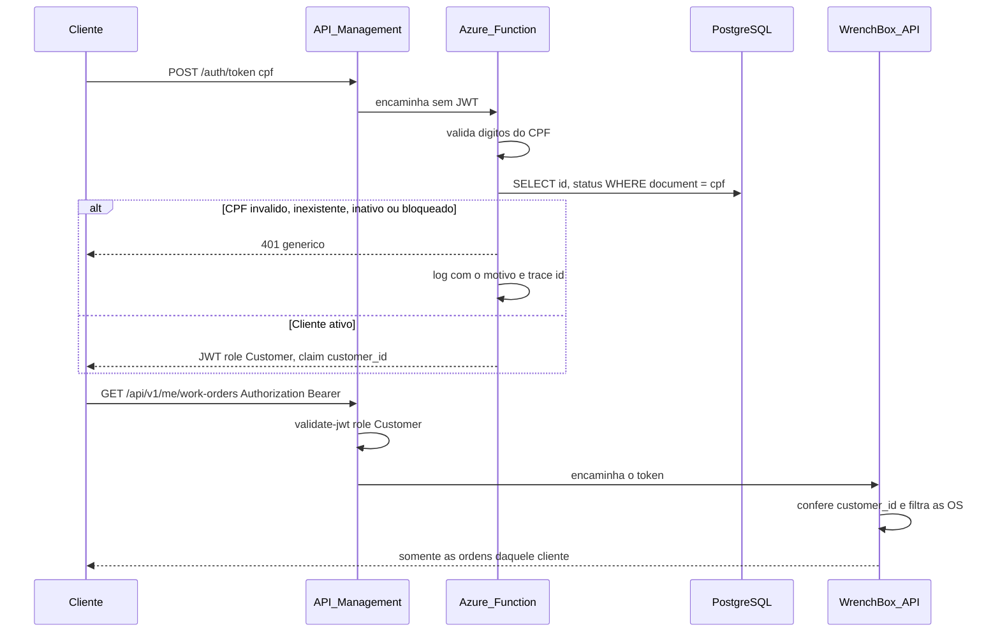

# Sequência — autenticação por CPF

O cliente não envia senha. A função confere o algoritmo do CPF, a linha em `customers` e o status. Só um cliente Ativo recebe token. A resposta de erro é sempre a mesma; o motivo vai para o log.

O administrador continua em `POST /api/v1/auth/login`. O gateway deixa essa rota aberta e exige role `Admin` no restante de `/api/v1`, exceto acompanhamento por e-mail e webhook, que têm segredo próprio.
